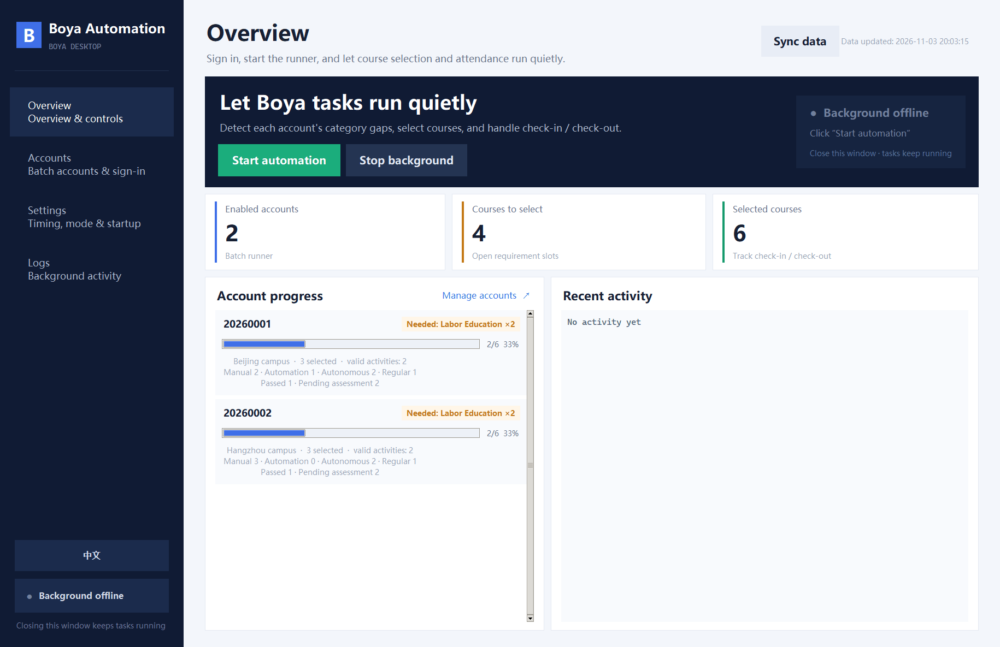
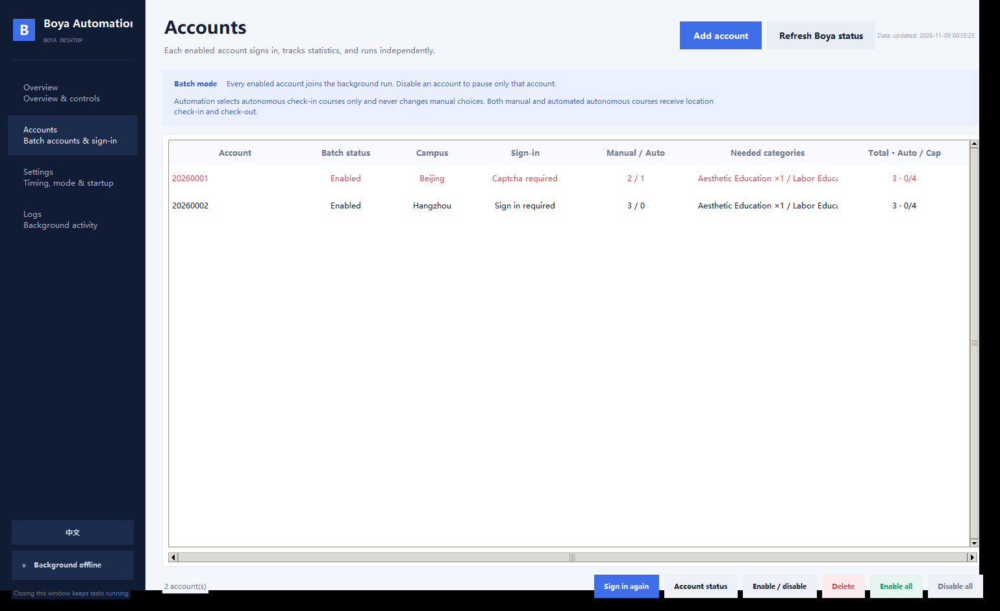
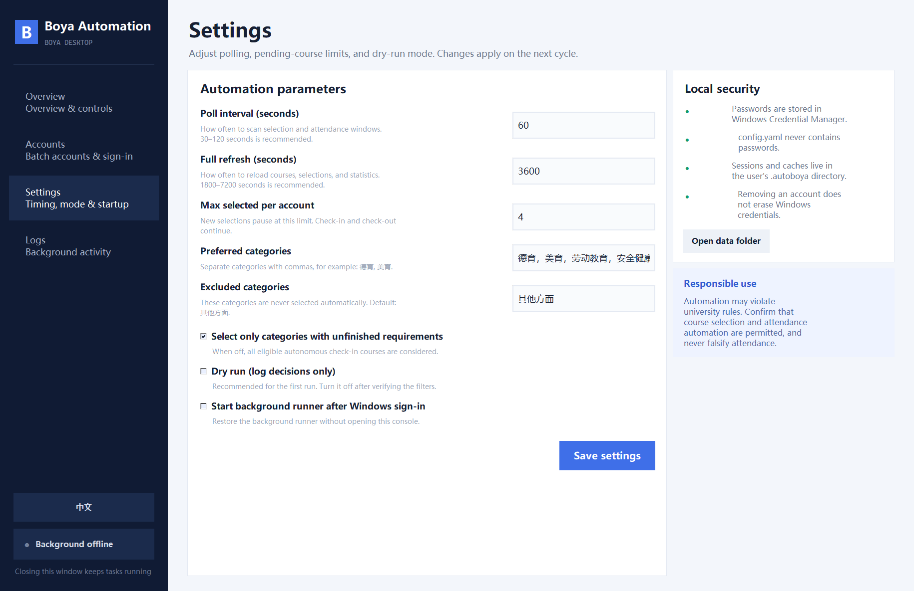
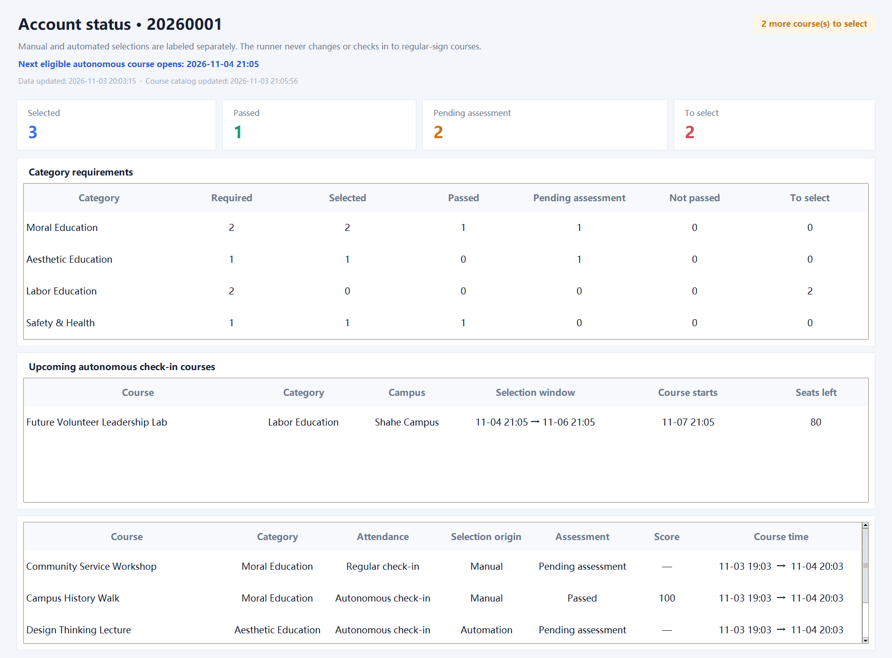
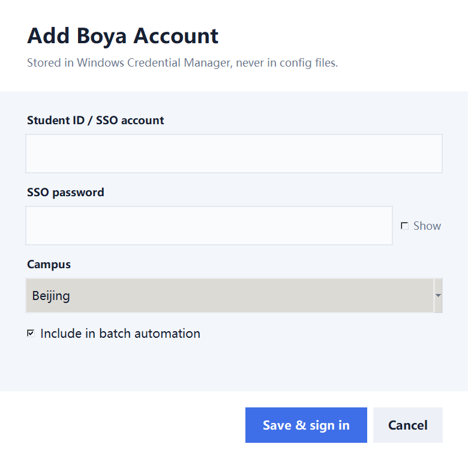

# Boya Automation

[English](README.md) | [简体中文](README.zh-CN.md)

**A bilingual Windows desktop controller for gap-aware BUAA Boya automation.**

[](https://github.com/ZhuangHT-1201/buaa-boya-desktop/actions/workflows/ci.yml)
[](https://github.com/ZhuangHT-1201/buaa-boya-desktop/releases/latest)
[](pyproject.toml)
[](LICENSE)

Boya Automation is a local-first desktop wrapper around
[AutoBoya](https://github.com/DeNeRATe-cool/AutoBoya). It turns the command-line workflow into
a visual multi-account controller: sign in through the university SSO, inspect the category gaps,
run unattended course selection, and keep the background runner alive after the console is closed.



> This is an independent community project and is not affiliated with Beihang University or the
> Boya platform. Automation may violate university rules. Verify that your use is permitted, and
> never falsify attendance.

## Highlights

- **Gap-aware selection** — selects autonomous check-in courses only when they help satisfy an
  unfilled category slot. Slots come from Boya statistics plus each chosen course's `pass` /
  attendance fields (`required - (selected - failed)`), so failed assessments keep triggering
  replacement selection.
- **Beijing-campus selection** — automation may select Beijing, Shahe, and all-campus autonomous
  check-in courses. Hangzhou-campus courses are excluded.
- **Strict autonomous-only selection** — regular-signin courses are rejected both while building the
  plan and again immediately before a selection request is sent.
- **Manual selections stay untouched** — existing courses are recorded as manual, never dropped or
  replaced, and shown separately from automation-selected courses.
- **True background operation** — the GUI launches a separate runner. Closing the console does not
  stop selection, check-in, or check-out.
- **Multi-account workflow** — every enabled account signs in, refreshes statistics, and executes
  independently while sharing the course catalog.
- **Recovery backoff and process safety** — concurrent console/worker sign-ins are serialized per
  account. Repeated OCR failures use exponential backoff instead of triggering a login storm.
- **One-click bilingual UI** — switch between English and Chinese from the sidebar. The choice is
  remembered for the next launch.
- **Visual status and logs** — inspect pending categories, selected courses, account progress, live
  activity, and the background PID without reading terminal output.
- **Session health monitoring** — expired sessions are detected from live Boya/WebVPN responses.
  Background re-login uses the stored password and local `ddddocr` CAPTCHA recognition (same approach
  used by common university SSO helpers). Only accounts that still cannot sign in are paused and
  highlighted, so check-in/out is not blocked by a single CAPTCHA prompt when OCR succeeds.
- **Dashboard recovery queue** — expired accounts are marked red on the overview, with one
  **Sign in all** action that handles CAPTCHA-protected accounts sequentially.
- **Per-account status details** — see required, selected, passed, pending, failed, and remaining
  selection counts, plus each course's attendance method, selection origin, result, and score.
- **Live Boya status refresh** — request a fresh online status check from the UI, with visible cache
  and catalog update timestamps.
- **Live course polling** — course availability is read directly on a faster independent interval;
  auto-selection pauses when that live catalog cannot be verified.
- **Upcoming course discovery** — lists future eligible autonomous check-in courses with campus,
  selection window, course start time, and remaining capacity.
- **Safe defaults** — local credential storage, a dry-run mode, a pending-course limit, excluded
  categories, and an optional delay between polling cycles.
- **Portable Windows build** — a single-file executable is published with each release.

## Screenshots

| Account management | Automation settings |
| --- | --- |
|  |  |

The per-account status view distinguishes pre-existing manual choices from automation-created
choices, and shows both category progress and each course's assessment state:



## How it works

1. The desktop console stores credentials in Windows Credential Manager and completes SSO sign-in.
2. The runner refreshes the shared course catalog plus each account's selected courses and statistics.
3. It maps unfilled requirement slots (`required - selected`) to category gaps, then filters eligible
   Beijing, Shahe, and all-campus autonomous check-in courses. Hangzhou courses are excluded.
   Courses with regular sign-in or no location sign point never pass the machine-selection gate.
4. At the configured time windows, it performs check-in or check-out for every selected autonomous
   course, regardless of whether the selection was manual or automated. Regular-signin courses are
   ignored.
5. The course catalog and account statistics refresh every five minutes by default. The same scan
   also builds a visible queue of future autonomous-course opportunities.

The console and worker are separate processes. Use **Stop background** in the app when you want to
end automation; closing the window only closes the console.

## Quick start

### Portable build

1. Download the latest release from the
   [Releases page](https://github.com/ZhuangHT-1201/buaa-boya-desktop/releases/latest).
2. Extract the archive.
3. Double-click `Launch Boya Automation.vbs`, or run
   `release\BoyaAutomation.exe`.
4. Open **Accounts**, choose **Add account**, and complete sign-in.
5. Return to **Overview** and choose **Start automation**.

The first launch can take several seconds because the single-file executable unpacks its runtime.



### From source

Requirements: Windows 10/11, Python 3.10 or newer, and Tk support included with the standard Python
installer.

```powershell
git clone https://github.com/ZhuangHT-1201/buaa-boya-desktop.git
cd buaa-boya-desktop
python -m venv .venv
.\.venv\Scripts\Activate.ps1
python -m pip install -r requirements-dev.txt
python -m boya_kit init
python -m boya_kit.launcher
```

For a one-click source installation, run:

```powershell
powershell -ExecutionPolicy Bypass -File .\scripts\bootstrap.ps1
```

## Language switching

Click the **English** or **中文** button at the bottom of the left sidebar. The full interface,
dialogs, status messages, and validation prompts switch immediately. The selected language is stored
locally in `~/.autoboya/ui-preferences.json`.

## Command-line interface

The original automation workflow remains available:

```powershell
python -m boya_kit init
python -m boya_kit setup
python -m boya_kit refresh
python -m boya_kit status
python -m boya_kit preview
python -m boya_kit run-once
python -m boya_kit run
python -m boya_kit stop
python -m boya_kit logs --lines 100
```

`setup` adds accounts to batch mode. Leave `username: null` in `config.yaml` to process every enabled
account; set it to one account only when you intentionally want a single-account command-line run.

## Configuration

The GUI writes `config.yaml` next to the executable. Passwords are never stored there.

| Key | Default | Purpose |
| --- | --- | --- |
| `username` | `null` | `null` processes all enabled accounts |
| `campus` | `北京` | Account metadata; course eligibility is enforced independently |
| `only_gap_categories` | `true` | Prefer courses that satisfy unfinished categories |
| `prefer_categories` | moral / aesthetic / labor / health | Gap priority order |
| `exclude_categories` | `其他方面` | Categories that are never selected automatically |
| `max_pending_selected` | `4` | Cap for pending automation-selected courses; manual selections are not counted or changed |
| `poll_seconds` | `60` | Selection and attendance scan interval |
| `refresh_seconds` | `300` | Full course, selection, and statistics refresh interval |
| `dry_run` | `false` | Log decisions without making real requests |

Use dry-run mode for the first refresh, verify the eligibility rules, and only then enable real
selections.

## Privacy and security

- Credentials are stored through the operating system keyring when available.
- Local sessions, statistics, courses, and logs live under `C:\Users\<you>\.autoboya`.
- Selection provenance is stored in `.autoboya/cache/selection_origins.json`. Existing entries migrate
  as manual selections; successful automation selections are marked separately.
- No account data is uploaded by this project.
- Removing an account from the GUI does not automatically erase its Windows Credential Manager entry.
- Do not attach passwords, cookies, session exports, or identifiable screenshots to public issues.

BUAA SSO sessions can expire. If reauthentication requires a CAPTCHA, open **Accounts**, select the
highlighted account, and choose **Sign in again**. Other valid accounts continue running meanwhile.

Please report vulnerabilities through GitHub's private vulnerability reporting rather than a public
issue. See [SECURITY.md](SECURITY.md).

## Build the Windows executable

```powershell
powershell -ExecutionPolicy Bypass -File .\scripts\build-exe.ps1
```

The build creates `release\BoyaAutomation.exe` and a Chinese-named compatibility executable. The
script uses a dedicated `.build-venv`, so build dependencies do not modify the application runtime.

## Project structure

```text
boya_kit/
  gui.py          Tkinter desktop console and bilingual UI
  i18n.py         English translation catalog
  runner.py       Gap-aware background automation
  selections.py   Manual/automation provenance and reconciliation
  service.py      Worker lifecycle, keyring, and login helpers
  cli.py          Typer command-line interface
docs/screenshots/ English interface screenshots
scripts/          Setup, launch, and packaging scripts
tests/            Localization and gap-filter tests
```

## Contributing

Contributions are welcome. Read [CONTRIBUTING.md](CONTRIBUTING.md), keep secrets out of commits, and
include verification for behavior changes.

## License

Released under the [MIT License](LICENSE).

The automation layer builds on the MIT-licensed
[AutoBoya](https://github.com/DeNeRATe-cool/AutoBoya) project. Its upstream limitations and
third-party notices continue to apply.
