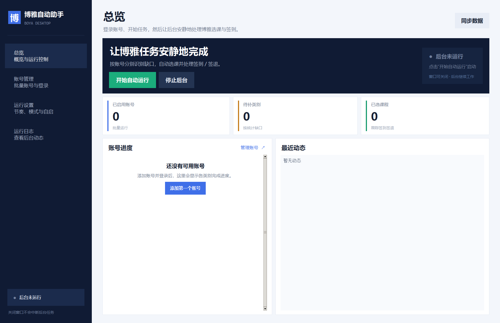
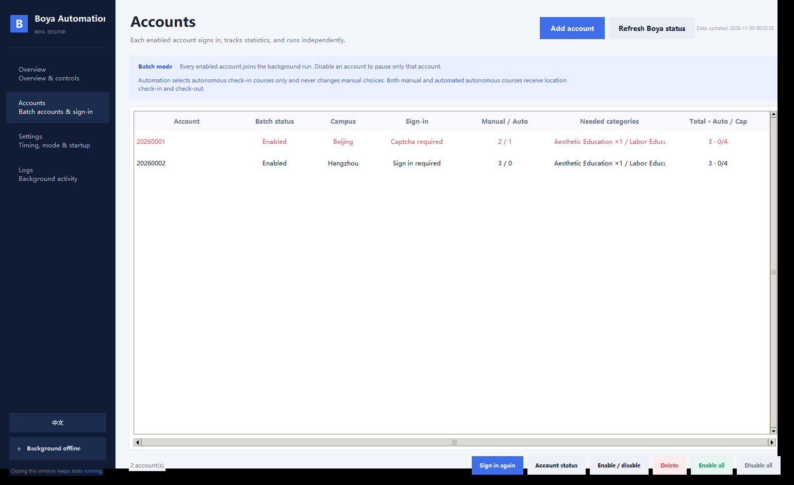
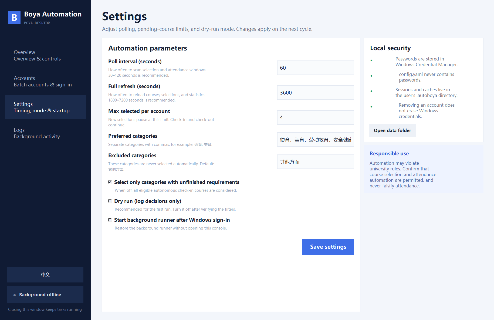
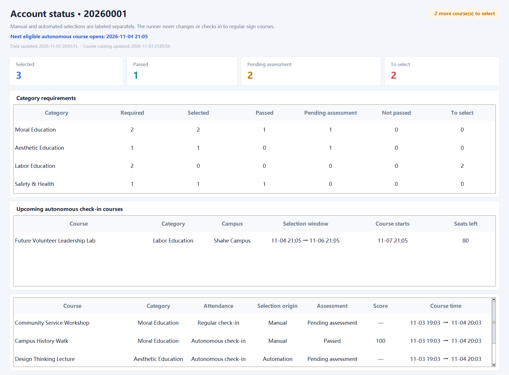
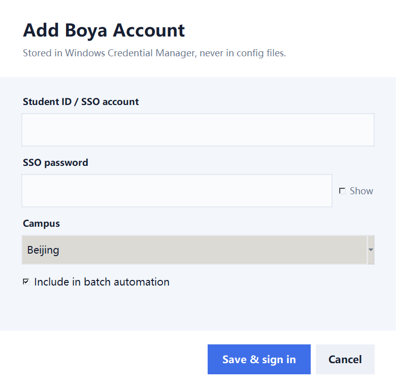

# 博雅自动助手

[English](README.md) | [简体中文](README.zh-CN.md)

**一个支持中英双语、按类别缺口自动选课的 Windows 博雅桌面控制台。**

[](https://github.com/ZhuangHT-1201/buaa-boya-desktop/actions/workflows/ci.yml)
[](https://github.com/ZhuangHT-1201/buaa-boya-desktop/releases/latest)
[](pyproject.toml)
[](LICENSE)

博雅自动助手是基于开源项目 [AutoBoya](https://github.com/DeNeRATe-cool/AutoBoya) 的本地桌面封装。
它把命令行流程整理为可视化多账号控制台：统一身份认证登录、查看类别缺口、自动选课、签到签退，
并且关闭控制台后后台任务仍会继续运行。



> 本项目是独立社区项目，与北京航空航天大学及博雅平台无隶属关系。自动化可能违反学校规定，
> 请先确认使用方式被允许，并避免任何虚假出勤行为。

## 主要功能

- 只选择能够补齐尚未占用类别名额的自主签到课程，待选数量按“要求数 − 已选数”计算。
- 自动只选择北京、沙河和全部校区的自主签到课程，杭州校区课程一律排除。
- 自动选课有双重硬校验：常规签到、没有定位签到点或已不在选课窗口的课程绝不会由机器选择。
- 已有选课统一登记为人工选课，不退课、不替换、不改选，并在界面中与机器选课分开标记。
- 控制台与后台进程分离，关闭窗口不会停止选课、签到或签退。
- 多个启用账号分别登录、刷新统计和执行，共享课程池。
- 侧边栏一键切换 English / 中文，并记住上次选择。
- 可视化查看账号进度、待补类别、已选课程、实时动态和后台状态。
- 每个账号可查看类别要求、已选、已通过、待考核、未通过和仍需选择数量，以及每门课的考核结果。
- 支持测试模式、已选课程上限、类别排除、轮询间隔与登录后自启。
- 提供免安装 Python 的单文件 Windows 发布包。

## 界面截图

| 账号管理 | 运行设置 |
| --- | --- |
|  |  |

账号状态页会区分人工/机器来源，同时显示类别要求和每门课程的考核结果：



## 快速开始

### 使用发布包

1. 从 [Releases](https://github.com/ZhuangHT-1201/buaa-boya-desktop/releases/latest) 下载最新版。
2. 解压到本地目录。
3. 双击 `Launch Boya Automation.vbs`，或直接运行 `release\BoyaAutomation.exe`。
4. 进入“账号管理”添加账号并登录。
5. 回到“总览”，点击“开始自动运行”。

单文件 EXE 首次启动需要解压运行时，可能会等待数秒。



### 从源码启动

要求 Windows 10/11、Python 3.10 或更新版本，并需要标准 Python 安装中自带的 Tk。

```powershell
git clone https://github.com/ZhuangHT-1201/buaa-boya-desktop.git
cd buaa-boya-desktop
python -m venv .venv
.\.venv\Scripts\Activate.ps1
python -m pip install -r requirements-dev.txt
python -m boya_kit init
python -m boya_kit.launcher
```

也可以运行一键源码安装脚本：

```powershell
powershell -ExecutionPolicy Bypass -File .\scripts\bootstrap.ps1
```

## 中英文切换

点击左侧栏底部的 **English** 或 **中文**，整个界面、弹窗、状态和校验信息会立即切换。
语言选择保存在 `~/.autoboya/ui-preferences.json`，下次启动自动恢复。

## 命令行

原有命令行功能仍然保留：

```powershell
python -m boya_kit init
python -m boya_kit setup
python -m boya_kit refresh
python -m boya_kit status
python -m boya_kit preview
python -m boya_kit run-once
python -m boya_kit run
python -m boya_kit stop
python -m boya_kit logs --lines 100
```

`setup` 添加的账号默认加入批量任务。`config.yaml` 中 `username: null` 表示处理全部启用账号。

## 配置

图形界面会把配置写到 EXE 同目录的 `config.yaml`，其中不会包含密码。

| 字段 | 默认值 | 作用 |
| --- | --- | --- |
| `username` | `null` | `null` 表示处理全部启用账号 |
| `campus` | `北京` | 账号校区信息；课程限制由独立规则执行 |
| `only_gap_categories` | `true` | 只优先补齐未完成类别 |
| `prefer_categories` | 德育 / 美育 / 劳动教育 / 安全健康 | 类别优先顺序 |
| `exclude_categories` | `其他方面` | 永不自动选择的类别 |
| `max_pending_selected` | `4` | 每账号机器已选未结束课程上限；人工选课不计数、不修改 |
| `poll_seconds` | `60` | 选课与签到扫描间隔 |
| `refresh_seconds` | `3600` | 全量课程与统计刷新间隔 |
| `dry_run` | `false` | 只记录决策，不执行真实操作 |

首次使用建议开启测试模式，确认筛选结果后再关闭。

## 安全与隐私

- 密码优先写入 Windows 凭据管理器。
- 会话、缓存和日志保存在 `C:\Users\<用户名>\.autoboya`。
- 选课来源保存在 `.autoboya/cache/selection_origins.json`；历史已选课程迁移为人工选课，机器成功
  选择的课程会单独标记。
- 本项目不会把账号数据上传到第三方服务器。
- 从界面删除账号不会自动清除 Windows 凭据。
- 不要在公开 Issue 中发布密码、Cookie、会话文件或可识别的账号截图。

安全问题请使用 GitHub 的私密漏洞报告功能，详见 [SECURITY.md](SECURITY.md)。

## 构建 EXE

```powershell
powershell -ExecutionPolicy Bypass -File .\scripts\build-exe.ps1
```

构建产物包括 `release\BoyaAutomation.exe` 和中文名称兼容版本。构建脚本使用独立的
`.build-venv`，不会污染运行环境。

## 项目结构

```text
boya_kit/
  gui.py          桌面控制台与中英文切换
  i18n.py         英文翻译表
  runner.py       按缺口过滤的后台自动化
  selections.py   人工/机器选课来源与状态核对
  service.py      后台生命周期、凭据与登录
  cli.py          命令行接口
docs/screenshots/ 英文界面截图
scripts/          安装、启动与打包脚本
tests/            语言与缺口筛选测试
```

## 参与贡献

欢迎提交 Issue 和 Pull Request。请先阅读 [CONTRIBUTING.md](CONTRIBUTING.md)，不要在提交中包含
密码、Cookie、个人缓存或个人账号截图。

## 许可证

项目使用 [MIT License](LICENSE)。

自动化层基于 MIT 许可的开源项目
[AutoBoya](https://github.com/DeNeRATe-cool/AutoBoya)。
